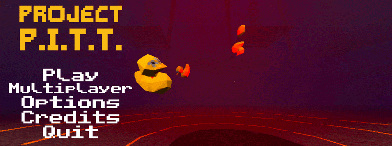

# PITT Multiplayer

<p align="center"></p>

Steam co-op multiplayer, built on **PittAPI**, a mod loader and modding API for **Project P.I.T.T. v1.0.8** (Steam app 4026250, Godot 4.7.2, GDScript).
Every change to the game goes through a command, every observation is a JSON-safe event, and every game
object has a stable integer id. On top of it, **PittMultiplayer** (`mods/PittMultiplayer/`) adds Steam
co-op: friends-only lobbies for up to 10 players, one host-simulated shared world (products, crates,
machines and tools synced, grab ownership), host-authoritative money / unlocks / phase, remote player
avatars and late join (see [Multiplayer](#multiplayer-pittmultiplayer)).

**Players:** grab the zip from [Releases](../../releases), unzip, double-click `Install.bat`.

**AI-assisted.** This project was written with AI assistance (Anthropic's Claude).
**Unofficial:** not affiliated with or endorsed by Froke, the developer of Project P.I.T.T. The official
P.I.T.T. community doesn't accept fully AI-generated mods, so please don't post or promote this mod in its
official spaces (Discord, etc.). You need to own the game on Steam; this repo contains none of the game's
code or asset files (the GIF above is a screen capture of the menu).

- Design: [`docs/API-DESIGN.md`](docs/API-DESIGN.md), multiplayer [`docs/mp/MP-DESIGN.md`](docs/mp/MP-DESIGN.md).
  Game internals: `docs/map/*.md`.
- Tests: [`TESTING.md`](TESTING.md).
- The game's code is not part of this repo, and neither is the decompiled reference the docs cite. To get
  your own local copy, recover your installed game with [GDRE Tools](https://github.com/GDRETools/gdsdecomp)
  into `decomp/` at the repo root; that folder is gitignored and must never be committed or redistributed.

## Install

Close the game, then from the repo root:

```powershell
powershell -ExecutionPolicy Bypass -File tools\install.ps1            # PittAPI + ExampleMod
powershell -ExecutionPolicy Bypass -File tools\install.ps1 -WithTests # also the live test mod
powershell -ExecutionPolicy Bypass -File tools\install.ps1 -WithMP    # also PittMultiplayer (co-op)
powershell -ExecutionPolicy Bypass -File tools\uninstall.ps1          # undo everything
```

The installer finds the game through Steam's `libraryfolders.vdf` (or `-GameDir`). It:

- copies `loader\` to `<game>\mods\PittAPI\` and `mods\ExampleMod\` to `<game>\mods\ExampleMod\`;
- backs up an existing `override.cfg` (`override.cfg.pittapi-backup-<timestamp>`) and merges one line into
  its `[autoload]` section: `PittAPI="*<game>/mods/PittAPI/pittapi.gd"`;
- records every file it wrote in `<game>\mods\PittAPI\.install.json`. `uninstall.ps1` deletes only those
  files and restores the backup (or deletes `override.cfg` if it created it).

It never touches the `.pck`, the game's scripts, or your saves. Steam "Verify integrity" leaves the extra
files alone. Start the game through Steam as usual (the game relaunches itself through Steam when started
directly).

### Where things live

| What | Where |
|---|---|
| Game saves (`savegame.save`, `savegame_2..10.save`, `sandbox.save`, `.bak/.tmp/.corrupt`, `profile.cfg`) | `%APPDATA%\Godot\app_userdata\Project P.I.T.T\` (the game's `user://` root). The game uses no Steam Remote Storage calls; Steam **Auto-Cloud** syncs this folder (`steam_autocloud.vdf`, `remotecache.vdf`). |
| PittAPI log (rotates at 2 MB, keeps 3) | `...\Project P.I.T.T\pittapi\pittapi.log` |
| Mod states (LOADED / FAILED / DISABLED / QUARANTINED + reason) | `...\pittapi\status.json` |
| Global settings | `...\pittapi\config\pittapi.cfg` (`log_level`, `dev_console`, `console_key`, `cheats_allowed`, `quarantine_threshold`, `quarantine_window_s`, `strict_game_version`) |
| Enable/disable mods | `...\pittapi\mods.cfg`, section `[enabled]`, `ModId=false` |
| Mod configs, keybinds, save sidecars | `...\pittapi\config\<id>.cfg`, `...\pittapi\keybinds.cfg`, `...\pittapi\saves\<save-key>\<id>.json` |

PittAPI never writes, renames or deletes `savegame*`, `sandbox.save*`, `profile.cfg`, `keybindings.cfg`
or `settings.cfg`. Every file write goes through `core/safe_fs.gd`, which refuses those names and
anything outside `user://pittapi/`.

## Writing a mod

```
<game>/mods/MyMod/
  mod.json
  main.gd
  extensions/hud_ext.gd    (optional)
```

`mod.json` (schema: `loader/schema/mod.schema.json`):

```json
{
  "id": "MyMod",
  "name": "My Mod",
  "version": "1.0.0",
  "api_version": "^1.0",
  "entry": "main.gd",
  "dependencies": {"SomeLib": ">=0.3.0"},
  "optional_dependencies": {},
  "load_order": 100,
  "extensions": [],
  "game_versions": ["1.0.8"],
  "multiplayer": "client_required",
  "enabled": true
}
```

`id` must equal the folder name. Dependencies load first, then `(load_order, id)`. A game version mismatch
is a warning unless `strict_game_version` is set.

`main.gd`:

```gdscript
extends Node
var api   # PittAPIContext; set before _ready, and passed to _mod_init

func _mod_init(p_api) -> void:
	api = p_api
	api.events.on("money.changed", _on_money)
	api.events.on("input.action", _on_key)
	api.input.register_action("hello", KEY_F8, "Say hello")
	api.commands.register("MyMod.double_money", _double, {"cheat": true, "schema": {}})
	api.hud.toast("MyMod loaded")

func _on_money(ev) -> void:
	api.log.info("money %s (%s%s)" % [ev.payload.money, "+" if ev.payload.sign > 0 else "-", ev.payload.delta])

func _on_key(ev) -> void:
	if ev.payload.mod == "MyMod" and ev.payload.name == "hello" and ev.payload.pressed:
		var r = api.spawn.spawn("duck", api.player.get_look_point(2.0))
		if r.done and not r.ok:
			api.hud.toast("spawn failed: " + r.error)

func _double(_args: Dictionary, ctx) -> Variant:
	var r = api.commands.execute("money.add", {"amount": api.state.get_money()})
	return ctx.fail(r.error) if r.done and not r.ok else {"money": api.state.get_money()}
```

`mods/ExampleMod/` is a complete, commented example (toast on load, an F7 key that prints money, phase and
money listeners, a cheat command, a console command, and a thin `hud.gd` extension).

### Rules

- Change game state only through `api.commands` (or the facades, which wrap commands). Reading game
  globals directly is tolerated; prefer the facades.
- Always check `result.done` (or `await result.completed` / `await api.commands.execute_async(...)`).
  Locally commands finish immediately; in multiplayer a client's command finishes when the host replies.
- Payloads and command args must be JSON-safe: null, bool, int, float, String, Array, Dictionary.
  Vector3/Transform3D/Color/BigInt/Node are converted (Nodes become entity ids). Callables and plain
  Objects are rejected.
- No `class_name` in mod scripts. Use `preload("relative.gd")`.
- Use the `api` handle. The global name `PittAPI` may not be usable from mod scripts in the shipped build
  (spike S3; the live boot suite reports it).
- Mod events must be named `mod.<YourId>.*`; mod commands `<YourId>.*`.
- File I/O only through `api.config`, `api.saves.mod_data_*`, `api.data_dir()` and reading your own folder.
- A mod's `_ready` runs before `_mod_init`; do your setup in `_mod_init`.

### Error isolation

GDScript has no try/catch, so isolation is layered:

1. Before anything runs: `mod.json` is validated and every script is compiled and checked with
   `can_instantiate()`. A broken mod is `FAILED`; its dependents fail too; everything else loads.
2. Each mod is its own node under `/root/PittAPI/Mods/<id>`. Every call into mod code goes through one
   guarded entry point, so a runtime error aborts only that call (it returns null) and the next handler
   still runs.
3. `ErrorGuard` is an engine `Logger` (`OS.add_logger`). It attributes each error to a mod by the
   script path (`<game>/mods/<id>/...`, in absolute or `res://` form), falling back to the mod whose code
   is currently running. Any error during `_mod_init`, or `quarantine_threshold` errors (default 50) within
   `quarantine_window_s` (10 s), quarantines the mod: its subscriptions, commands, keybinds, console
   commands and panels are removed, its node is disabled, a toast appears, and it is disabled in
   `mods.cfg` for the next boot. Script extensions cannot be undone until restart.
4. A contract self-check at boot verifies every game member PittAPI uses
   (`loader/core/contract.gd`). After a game update a missing member switches off only that feature
   (its commands return `ERR_UNAVAILABLE`).

## API reference (summary)

Each mod receives a `PittAPIContext` (`api`) with: `mod_id`, `mod_dir`, `version`, `api_version`,
`game_version`, `log`, `config`, `events`, `commands`, `entities`, `state`, `spawn`, `player`, `hud`,
`input`, `saves`, `console`, `net`, `extensions`, plus `has_mod(id)`, `get_mod_api(id)` (the other mod's
`get_public_api()`), `invoke(callable, args)`, `data_dir()`, `pittapi_dir()`, `recent_errors()`,
`list_mods()`.

| Facade | Main calls |
|---|---|
| `events` | `on(name, handler, priority=0) -> id` (`"*"` and `"prefix.*"` allowed), `once`, `off(id)`, `emit("mod.<id>.x", payload) -> Error`, `last(name)`, `await wait(name, timeout_s)`. Event: `{name, payload, seq, t_ms, origin, source}` |
| `commands` | `register(name, handler(args, ctx), {schema, cheat, authority_only, replicate, description})`, `execute(name, args) -> PittCommandResult {id, ok, value, error, code, done, completed}`, `await execute_async(...)`, `list()`, `describe(name)`. Handlers fail with `return ctx.fail("why")` |
| `state` | `get_money() -> "digits"`, `money_compare`, `can_afford`, `add_money`, `spend`, `set_money` (cheat), `get_bank`, `set_bank` (cheat), `buy(category, key, subkey)`, `get_phase`, `get_phase_name`, `get_phase_progress`, `set_phase` (cheat), `is_in_world`, `is_sandbox`, `is_unlocked`, `get_unlocked`, `force_unlock` (cheat), `register_milestone`, `get_item`, `get_item_keys`, `get_stat("products_consumed.duck")`, `snapshot()`, `bigint_from` |
| `spawn` | `pools()`, `is_ready()`, `headroom(pool)`, `spawn(pool, pos, rot, {velocity, meta}) -> result.value.entity_id`, `despawn(id)`. Always through `ObjectPoolManager`; `ERR_UNAVAILABLE` before Play |
| `entities` | `id_of(node)`, `get_node(id)`, `track(node, static_key="")`, `untrack`, `describe(id)`, `list({pool_id, kind, within})`, `key_of(id)` |
| `player` | `get_local()`, `get_camera()`, `get_position()`, `get_look_transform()`, `get_look_point(d)`, `get_held()`, `get_equipped()`, `get_focus()`, `teleport(pos)`, `impulse(v)`, `set_movement_locked(bool)` |
| `hud` | `toast(text, {duration, color})` (own layer, works on the main menu), `banner(text)` and `floating_text(text, color)` (World HUD only), `add_panel(id, control)`, `remove_panel(id)` |
| `input` | `register_action(name, KEY_X, label) -> "mod_<id>_<name>"`, `rebind`, `get_key`, `get_key_name`, `is_pressed`, `conflicts`. Presses arrive as `input.action` events |
| `config` | `define(key, default, {section, type, min, max, options, description})`, `get_value`, `set_value -> Error`, `flush()`, signal `changed` |
| `saves` | `get_active_save_key()`, `get_slot_infos()` (read-only), `mod_data_get/set` (sidecar, flushed when the game saves), signal `mod_data_loaded` |
| `console` | `register(name, handler(args) -> String, help)`, `run(line)`. Panel with `dev_console=true`, key `` ` `` |
| `net` | `is_authority()`, `local_peer_id()`, `is_multiplayer()`, `get_peers()`, `get_players()`, `get_peer_info(peer)`, `get_session_info()`, `is_applying()`; signals `session_started`, `session_ended`, `peers_changed`. Provider-only calls: see [Multiplayer](#multiplayer-pittmultiplayer) |

**Events (v1):** `game.boot_complete`, `scene.changed`, `world.ready`, `world.exited`, `money.changed`
(`{money, delta, sign, reason}`), `bank.changed`, `stat.changed`, `phase.changed`, `phase.settled`,
`ending.started`, `combo.started|updated|ended|broken|mega`, `unlock.milestone`, `item.level_changed`,
`product.crafted`, `product.sold`, `product.recycled` (`{value, entity_id}`; recycle cubes are not sales), `entity.spawned`, `entity.despawned`, `player.ready`,
`player.held_changed`, `player.equipped_changed`, `gate.opened`, `save.loaded`, `save.applied`,
`save.saved`, `ui.menu_changed`, `input.action`, `command.executed`, `mods.quarantined`,
`net.authority_changed`, `net.session_started`, `net.session_ended`, `net.peers_changed`, `mod.<id>.*`.

**Core commands:** `money.add`, `money.spend`, `money.set`*, `bank.set`*, `item.buy`, `phase.set`*,
`unlock.force`*, `unlock.register_milestone`, `entity.spawn`, `entity.despawn`, `entity.set_transform`,
`entity.impulse`, `player.teleport`, `player.impulse`, `achievements.suppress`, `perf.pin_physics`,
`save.isolate`, `presence.suppress` (* = cheat; refused when `cheats_allowed=false`; scope "local":
`player.teleport`, `player.impulse`, `achievements.suppress`, `perf.pin_physics`, `save.isolate`,
`presence.suppress`). Any command a mod
registers with `cheat: true` also marks the active save's mod data as cheated when it succeeds.

## Script extensions

List them in `mod.json` `extensions`. PittAPI applies them with `take_over_path` in its `_init`, before
the main menu loads. An extension must start with `extends "res://scripts/<target>.gd"`, call `super`, and
have no `class_name`. Two mods extending the same script stack. Keep them thin and forward to your mod:

```gdscript
extends "res://scripts/hud.gd"
func show_result(combo_level, total_bonus):
	super.show_result(combo_level, total_bonus)
	var core = get_node_or_null("/root/PittAPI")
	if core != null and core.has_method("ext_hook"):
		core.ext_hook("MyMod", "combo_paid", {"level": combo_level})   # -> event mod.MyMod.combo_paid
```

Refused (`FAILED` with the reason): the 20 autoload scripts (read from ProjectSettings at runtime),
`big_int.gd`, scripts of autoload scenes, and any script already loaded before PittAPI. Use their signals,
polling, or a scene-script call site instead (see `docs/API-DESIGN.md` section 4.2).

## Multiplayer (PittMultiplayer)

`mods/PittMultiplayer/` is the co-op mod: main menu **Multiplayer** > Host (friends-only Steam lobby,
up to 10) or Join (friends' lobbies); the host presses Start and picks a save; friends can join a running
game. Since MP2 it is **one host-simulated shared world**: every duck, tool, machine and puzzle exists once,
the host simulates it and every client sees it move; money, unlocks, phase, combos and the hole are one
co-op state owned by the host; grabs are predicted and handed over (design `docs/mp/MP2-DESIGN.md`, results
`docs/mp/MP2-TEST-REPORT.md`). Player guide, settings and limitations:
[`mods/PittMultiplayer/README.md`](mods/PittMultiplayer/README.md).
Tests: headless `test_mp_*` / `test_mp2_*`, two or three instances on one PC
(`tools\test-mp-loopback.ps1 -Suite mp1|mp2|all [-Clients 2] [-HostLive | -ClientLive] [-SteamLanes 4]`), and the manual Steam checklist
[`docs/mp/MANUAL-STEAM-TEST.md`](docs/mp/MANUAL-STEAM-TEST.md).

PittAPI 1.1 additions it relies on (usable by any mod):

- **Command scope** (`register(..., {"scope": "local"})`): runs on the machine that issues it, never sent to
  the host, refused from remote senders. `save.isolate`, `perf.pin_physics`, `achievements.suppress`,
  `presence.suppress`, `player.teleport` and `player.impulse` are local. Everything else (default
  `"authority"`) runs on the host during a session: a client mod's `entity.spawn` spawns in the host's world.
- **`"provides": ["net"]`** in `mod.json`: the one mod allowed to call the `api.net` provider section
  (`install_authority`, `uninstall_authority`, `emit_session_started/ended`, `emit_peers_changed`,
  `register_remote_player`, `begin_apply` / `end_apply`). A second provider FAILs.
- `api.net`: `is_multiplayer()`, `get_players()`, `get_peer_info(peer)`, `get_session_info()`,
  `is_applying()`; signals `session_started` / `session_ended` / `peers_changed` (also events
  `net.session_started`, `net.session_ended {reason}`, `net.peers_changed {players}`). Events emitted
  while replicated state is applied carry `source == "net"` and the host's peer as `origin`
  (`money.changed.reason == "net"`).
- `api.contract_check(entries)`: a mod's own game contract checked with the core checker (autoloads
  live, `res://` scripts by introspection).
- Editor builds: `--pittapi-instance=<name>` moves the PittAPI root to `user://pittapi-<name>/` (two dev
  instances in one user dir); the `save.isolate` prefix follows it.

### Authority seam

`core/authority.gd` is the seam: the local authority dispatches every command envelope immediately;
PittMultiplayer's `net/mp_authority.gd` (installed with `api.net.install_authority`) sends client
envelopes to the host and completes results when replies arrive. Entity ids are authority-allocated
(pooled; a non-authority peer allocates none) or key-hashed (fixtures, identical on every peer). Players
use ids 1..999 (one slot per peer, the local player is 1). Remote envelopes must go through
`Commands.dispatch_remote(envelope, sender_peer)`: it re-runs every gate (JSON safety, schema, cheat,
feature, `authority_only`) and takes the origin from the transport, never from the envelope; the claimed
`mod` is only a label (`ctx.is_remote`). Mods get a restricted `api.entities` view (lookups, plus
`track`/`untrack` of their own nodes) and `api.events.off()` only removes their own subscriptions.
Late join uses the game's own save collectors (PittMultiplayer `sync/snapshot.gd`), not `state.snapshot()`.
`mod.json` `multiplayer` (`client_required | host_only | local_only`) feeds the lobby check: PittMultiplayer
compares `mods_hash` = sha256 of the sorted `id@version` of every loaded `client_required` mod.

## Implementation notes (differences from the design)

- `save.isolate {enabled, path?}` was added. The elevator's `_ready` sets `SaveManager.save_locked = false`
  (elevator.gd:57), so the test isolation re-asserts `save_locked = true` / `autosave_enabled = false`
  and the active save path every frame while enabled. The path (default `user://pittapi/test/isolated.save`)
  must be a `.save` under `user://pittapi/` and not slot-like; the redirect matters because the ending's
  `SaveManager.save_game(true)` ignores `save_locked`. Disabling restores the previous path and flags.
  The ending also writes `profile.cfg` (`game_completed`) directly, so `phase.set 5` is refused while
  isolation is on.
- Sidecar mod data: a new run (`world.ready` with `new_game`) replaces the whole
  `saves/<key>/` folder on its first save, so data and the cheated flag of an earlier run in the same key
  (e.g. after the game's `clear_sandbox_slot()` / `delete_slot()`) never come back. Orphaned sidecars are
  cleaned at boot, on `save.loaded` and on `world.ready`.
- Error capture in the shipped (release) build: GDScript VM runtime errors (call on null, bad property
  access) are not reported to loggers at all and the function keeps running (live check
  `S4.release_reports_script_errors`). Engine (C++) errors and parse/load errors are captured and
  attributed (by the guard scope, since release builds give no script backtraces). Quarantine therefore
  only sees those in release.
- `saves.get_slot_infos()` reads the slot files and `profile.cfg` itself: the game's own
  `get_slot_info()` writes a cache entry into `profile.cfg` when one is missing.
- `item.buy` checks affordability before calling `GameState.buy` (the game spawns the auto workbench
  before its own affordability check, game_state.gd:1083).
- Mod ids may start with `_`; such folders are test fixtures, skipped unless a test run is armed.
- Extensions forward through `PittAPI.ext_hook(mod_id, hook, payload)` (emits `mod.<id>.<hook>`).
- Command results carry a `code` (`ERR_UNKNOWN`, `ERR_INVALID`, `ERR_DENIED`, `ERR_UNAVAILABLE`,
  `ERR_FAILED`).
- `item.buy_tool`, controls-menu rows for mod keybinds, and autoload replacement through override.cfg
  (spike S4) are not implemented.

## License

MIT, see [`LICENSE`](LICENSE). **Notice:** the MIT license covers this repository's own code and docs only.
It grants nothing for Project P.I.T.T. itself; the game, its code and its assets belong to its developer.
